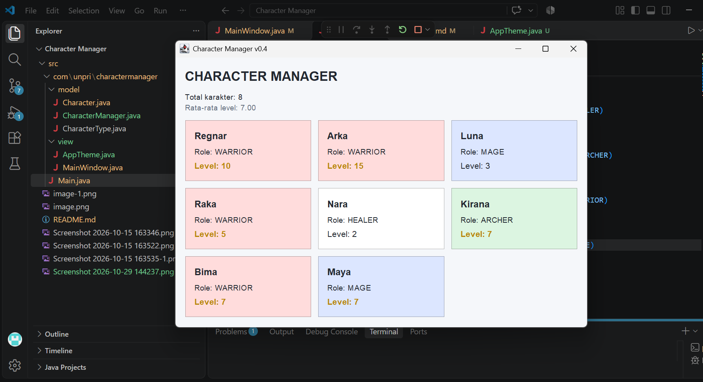

## TP5 — Character Manager Sprint #2

### 1. Fitur Baru

Pada tugas TP5 ini, program Character Manager dikembangkan dengan fitur-fitur berikut:

- `addCharacter()` untuk menambahkan karakter dan menolak nama duplikat.
- `findByName()` untuk mencari karakter berdasarkan nama.
- `removeCharacter()` untuk menghapus karakter berdasarkan nama.
- `getTotalCharacters()` untuk menghitung jumlah karakter.
- `getAllCharacters()` untuk mengembalikan salinan daftar karakter.
- `getAverageLevel()` untuk menghitung rata-rata level dan mengembalikan `0.0` jika daftar kosong.
- `findByType()` untuk mencari karakter berdasarkan tipe.
- `countByType()` sebagai fitur analitik tambahan untuk menghitung jumlah karakter berdasarkan tipe.

### 2. Screenshot Output CRUD

Pengujian CRUD dilakukan untuk membuktikan bahwa program dapat menambahkan karakter, mencari karakter, menghapus karakter, dan menolak penambahan nama duplikat.


### 3. Eksperimen Reference dan Defensive Copy

Eksperimen reference menunjukkan bahwa ketika variabel `b` dibuat menggunakan `Character b = a;`, kedua variabel menunjuk objek yang sama. Perubahan level melalui `b` juga memengaruhi nilai yang dibaca melalui `a`, dan ekspresi `a == b` menghasilkan `true`.

Untuk membuat objek independen, dibuat objek baru menggunakan constructor `new Character(...)`. Objek baru memiliki reference berbeda sehingga perubahan levelnya tidak otomatis mengubah objek awal.

Pengujian defensive copy menunjukkan bahwa menghapus isi daftar hasil `getAllCharacters()` tidak menghapus karakter dari daftar internal `CharacterManager`.

![Screenshot Eksperimen Reference]
(<Screenshot 2026-10-15 163346.png>)
(<Screenshot 2026-10-15 163522-1.png>)
(<Screenshot 2026-10-15 163535-1.png>)

### 4. Fitur Analitik Rancangan Sendiri

Fitur tambahan yang dibuat adalah `countByType(CharacterType type)`.

Method ini menghitung jumlah karakter berdasarkan tipe tertentu tanpa mengekspos `ArrayList` internal.

Contoh penggunaan:

```java
manager.countByType(CharacterType.WARRIOR);
```

Jika terdapat dua karakter bertipe `WARRIOR`, method mengembalikan nilai `2`.

Fitur ini memudahkan analisis jumlah karakter berdasarkan tipe. Method dilengkapi Javadoc dan menjaga enkapsulasi karena hanya mengembalikan hasil perhitungan, bukan daftar internal.

### 5. Google Docs — Analisis Bagian D

Analisis Bagian D membahas:
1. Perbedaan reference dan primitive value.
2. Alasan `totalCharacterCreated` menggunakan `static`.
3. Alasan `equals()` perlu di-override untuk memeriksa nama duplikat.
4. Risiko jika `getAllCharacters()` mengembalikan `ArrayList` asli.
5. Hubungan reference dengan defensive copy.

**Link Google Docs:** [Buka Analisis Bagian D](https://docs.google.com/document/d/1SSIexANsS156Lu-YPYz8dWmNxNgLhOr5TXCtoL8DPhk/edit?usp=sharing)


## TP8 — Implementasi GUI Character Manager

### 1. Hasil Implementasi

Aplikasi Character Manager dikembangkan menggunakan Java Swing. Jendela utama menampilkan daftar karakter secara dinamis, meliputi nama, tipe karakter, dan level. Aplikasi juga menampilkan statistik rata-rata level seluruh karakter yang dikelola oleh CharacterManager.

**Screenshot sebelum perubahan data:**


**Screenshot sesudah perubahan data:**


### 2. Aliran Data dan Prinsip MVC

Aliran data dimulai dari Main.java yang membuat objek CharacterManager dan menambahkan data karakter. CharacterManager menyimpan serta mengelola kumpulan karakter, sedangkan MainWindow mengambil data tersebut melalui method getAllCharacters() dan menampilkannya menggunakan JLabel dalam perulangan. MainWindow juga mengambil nilai rata-rata level dari CharacterManager untuk ditampilkan di bagian bawah daftar. Pembagian ini menerapkan prinsip MVC: Character dan CharacterManager berperan sebagai Model, MainWindow sebagai View, sedangkan Main menginisialisasi objek dan menghubungkan Model dengan View. Pada aplikasi yang lebih besar, pengendalian interaksi dapat dipisahkan ke Controller tersendiri.

### 3. Karakter Baru

- **Freya — MAGE, level 12:** dipilih untuk menambah variasi level pada tipe penyihir.
- **Aldric — HEALER, level 20:** dipilih untuk menambahkan tipe penyembuh dan memperluas variasi level karakter.

### 4. Statistik

Setelah kelima karakter ditambahkan, jumlah level adalah 65 dengan rata-rata 13,00. Nilai tersebut dihitung berdasarkan data karakter yang dikelola oleh CharacterManager, bukan ditulis secara tetap di GUI.

### 5. Dokumentasi Analisis

Link Google Docs Bagian D: [https://docs.google.com/document/d/1rtMcYTYg-kMUiohkacpK41TwihrFspRS_YsXwG5iSBs/edit?usp=sharing]


# TP10 - Character Manager

## Deskripsi

Character Manager adalah aplikasi desktop berbasis Java Swing yang digunakan untuk menampilkan data karakter dalam bentuk kartu. Proyek ini merupakan pengembangan antarmuka versi 0.4 dengan penerapan tema visual dan pemisahan tanggung jawab class.

## Tujuan

- Memahami penerapan OOP dalam aplikasi Java.
- Memisahkan pengelolaan data dan tampilan aplikasi.
- Menggunakan AppTheme untuk mengatur desain antarmuka.
- Menampilkan informasi karakter secara terstruktur.
- Menerapkan perbedaan tampilan berdasarkan role dan level karakter.

## Teknologi

- Java
- Java Swing
- Visual Studio Code
- Git dan GitHub

## Fitur Utama

- Menampilkan enam karakter.
- Menampilkan nama, role, dan level.
- Warna kartu berbeda berdasarkan role karakter.
- Level minimal 5 ditampilkan dengan warna emas dan font tebal.
- Menampilkan jumlah karakter.
- Menghitung rata-rata level karakter.
- Menampilkan informasi tambahan melalui tooltip.

## Struktur Program

```text
src/
└── com/
    └── unpri/
        └── charactermanager/
            ├── Main.java
            ├── model/
            │   ├── Character.java
            │   ├── CharacterManager.java
            │   └── CharacterType.java
            └── view/
                ├── AppTheme.java
                └── MainWindow.java
```

## Pengujian

Pengujian dilakukan untuk memastikan:

1. Aplikasi dapat dijalankan.
2. Seluruh karakter tampil dengan benar.
3. Warna kartu sesuai dengan role.
4. Level tinggi ditampilkan dengan penanda khusus.
5. Jumlah karakter dan rata-rata level dihitung dengan benar.

## Dokumentasi

**Screenshot sebelum perubahan**


**Screenshot sesudah perubahan**


## Google Docs
https://docs.google.com/document/d/1sAtDeQZZj2kVs94TOLaSVdip59FUTPXp7M2KCwu-RXQ/edit?usp=sharing


## Kesimpulan

Melalui proyek ini, konsep OOP dan pemisahan tanggung jawab diterapkan dalam pengembangan aplikasi Java Swing. Penggunaan AppTheme dan MainWindow membuat tampilan lebih konsisten, sedangkan CharacterManager membantu mengelola data karakter secara terpisah. Proyek ini dapat dikembangkan lebih lanjut dengan fitur pencarian, pengeditan, penghapusan, dan penyimpanan data karakter.

